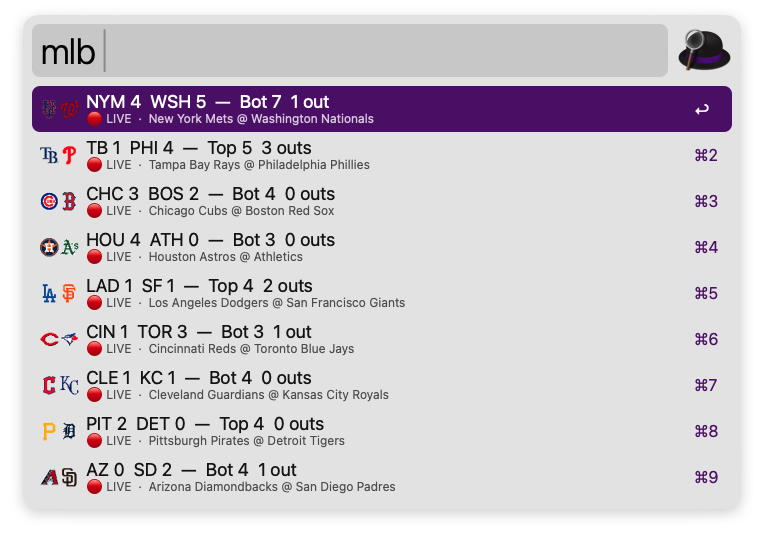
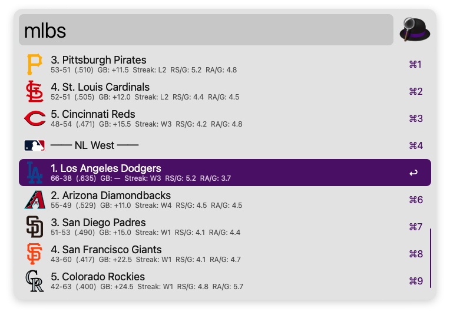
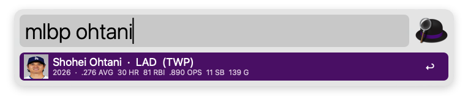
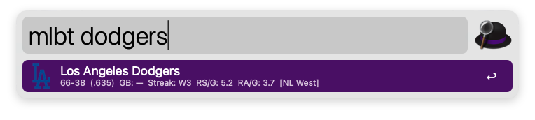

# ⚾ MLB Scores — Alfred Workflow

[](https://www.alfredapp.com/)
[](https://www.python.org/)
[](https://opensource.org/licenses/MIT)

Check live MLB scores, standings, player stats, and team stats directly from Alfred.  
Powered by MLB's **free official Stats API** — no API key or account required.

---

## 📦 Installation

1. Download the latest `MLB_Workflow_V1.alfredworkflow` (or `alfred-mlb-scores.alfredworkflow`) from [GitHub Releases](https://github.com/PopBot/alfred-mlb-scores/releases).
2. Double-click the downloaded file to install into Alfred 5.
3. No configuration required — start searching immediately!

---

## ⌨️ Keywords

All four triggers activate immediately in Alfred:

| Keyword | What it shows | Example |
| :--- | :--- | :--- |
| `mlb` | Today's live, upcoming & final scores | `mlb` |
| `mlbs` | Current standings grouped by division | `mlbs` |
| `mlbp` | Player stats & season performance | `mlbp ohtani` |
| `mlbt` | Team stats, record & split stats | `mlbt dodgers` |

---

## 🎮 Features & Usage

### 1. `mlb` — Today's Scores
Type `mlb` to view all games for today, sorted automatically: 🔴 **Live** → ⏰ **Upcoming** → ✅ **Final**.



- **Press <kbd>↩</kbd> (Enter)** on any game → opens the box score on MLB.com.
- **Hold <kbd>⌘</kbd> + <kbd>↩</kbd>** → opens the live box score directly.
- **Dual team logos**: Away team logo on the left, home team on the right.
- **Auto-refresh**: Live scores automatically re-query every 30 seconds.
- **Local Time**: Game times are converted to your Mac's local system timezone automatically.

### 2. `mlbs` — Standings
Type `mlbs` to view full standings across all 6 divisions (AL East, Central, West; NL East, Central, West).



- Each team shows: `W-L (PCT)  GB: --  Streak: W3  RS/G: 4.8  RA/G: 3.2`
- **Press <kbd>↩</kbd>** → opens team schedule on MLB.com.
- **Hold <kbd>⌘</kbd>** → opens team schedule.
- **Hold <kbd>⌥</kbd>** → opens team roster.

### 3. `mlbp` — Player Stats
Type `mlbp` followed by a player's name (e.g. `mlbp judge`, `mlbp skenes`):



- **Hitters**: AVG · HR · RBI · OPS · SB · G
- **Pitchers**: ERA · WHIP · K · W-L · IP · GS
- Displays official player headshot from MLB CDN (cached locally).
- **Press <kbd>↩</kbd>** → opens player profile page on MLB.com.

### 4. `mlbt` — Team Stats
Type `mlbt` followed by a team name, city, abbreviation, or division (e.g. `mlbt yankees`, `mlbt lad`, `mlbt nl west`):



- **Default view**: Current record, win %, games back, streak, runs scored/allowed per game.
- **Hold <kbd>⌘</kbd>**: Preview team batting statistics (AVG, HR, RBI, OPS, SB).
- **Hold <kbd>⌥</kbd>**: Preview team pitching statistics (ERA, WHIP, K, SV).
- **Press <kbd>↩</kbd>** → opens team stats on MLB.com.

---

## ⚡ Performance & Caching

- Uses Alfred's official workflow cache directory (`$alfred_workflow_cache`), with fallback to a local `.cache` folder.
- **Live scores**: 30-second TTL cache with stale-while-revalidate for instant results.
- **Standings & Team Stats**: 5-minute TTL cache.
- **Player Roster**: 1-hour TTL cache.
- **Headshots & Matchup Logos**: 7-day TTL cache.

---

## 🛠️ Development & Building

To package changes into the workflow file:
```bash
python3 build.py
```
This generates a clean, compressed `.alfredworkflow` ready for distribution.

---

## 📡 Data Source & Credits

All data is fetched from the official [MLB Stats API](https://statsapi.mlb.com/api/v1/).  
Team logos are provided by ESPN CDN.  
Player headshots are provided by the MLB Photo CDN.

Created with ❤️ by [Jarod Wong](https://github.com/PopBot).
